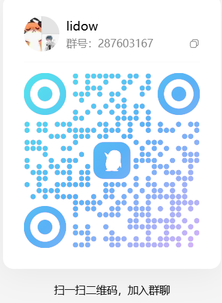

<div align="center">


# Lidow

**零 Token 成本的内嵌网页版 AI Agent 桌面端**

嵌入 AI 网页版会话，让 AI 直接驱动你本地的工具——不申请 API Key、不按 Token 计费。

[](https://github.com/cv-superding/lidow/releases)
[](https://github.com/cv-superding/lidow/actions/workflows/ci.yml)
[](LICENSE)
[](#快速开始)
[](#它是什么)
[](https://www.electronjs.org/)
[](https://react.dev/)
[](https://www.typescriptlang.org/)
[](#快速开始)
[](#快速开始)
[](https://github.com/cv-superding/lidow/pulls)

`Electron 45` · `TypeScript strict` · `React 19` · `TailwindCSS 4` · `GPL-3.0`

</div>

---

## 它是什么

Lidow 把 DeepSeek / Claude / ChatGPT / 豆包 / 通义千问 / 文心一言 / Kimi / 智谱清言的**网页版**装进桌面窗口，
注入一层轻量 overlay：AI 回复中的工具调用代码块（```lidow）被解析后在本地沙箱执行，
结果自动回传给 AI——形成「思考 → 行动 → 观察」的真 Agent 循环。

你在网页里用自己的免费额度，AI 却拥有读写文件、跑命令、查数据库、联网检索的完整手脚。

## 核心特性

**Agent 内核**
- 全工具集（19 个）：read / write / edit（保换行 + diff 卡片）/ glob / grep / bash / pwsh / webFetch / webSearch / mysql / deleteFile / todoWrite / injectJS / clipboard / screenshot / sysinfo / mcpCall / kbSearch / remember
- 三层停止：面板按钮 + 悬浮球右键，分别中断网页生成 / 工具执行 / 自动循环
- 稳定性：90s SSE 看门狗、自动重试、上下文自动压缩（可手动）、tok/s 实时显示、填入读回校验 + 发送重试
- 会话血缘：多窗口并发严格隔离（修复上游 #24），支持分叉、自动命名、压缩摘要、导出 Markdown

**生态**
- Skill / Agent / Rules 三级体系（项目级 `.lidow/` + 用户级 `~/.lidow/`，渐进式披露）
- 用户记忆：remember / forgetMemory 工具 + 侧边栏管理
- MCP：Claude Desktop 配置格式兼容，资源 / 提示 / 工具三组件
- 插件市场：GitHub + Gitee 双源发现（走系统代理，失败原因可见）+ 内置精选本地直装；插件启动即加载（dsh / entry / webScript 三类入口真实生效）
- DSH 兼容宿主：**119 个 Context 服务名全兼容**——48 个 native 真实映射、14 个事件桥、57 个 KV 兜底（保证插件调用不崩溃、数据可持久化，但非完整实现；[分档明细](docs/dsh-coverage.md)）

**安全**
- 危险命令复合检测（rm 语义解析、管道注入、变体归一化）+ UI 二次确认
- SSRF 防护（私网/回环/元数据端点，重定向逐跳校验）
- 工具路径锁定项目目录；执行审计全留痕，文件操作**单步回滚**
- 安全 MOD（可选）：CTF 授权模式提示、AI 拒绝检测与续写（上限防循环）

**体验**
- 三栏极简布局（Cursor 风格）：图标栏 hover 展开 + 沉浸 webview 标签 + 可收起 Harness 面板
- **右侧工具侧栏**（Qoder 风格）：文件 / 任务 / 终端 / 审阅，可拖拽调宽；文件变更卡一键展开 diff 审阅
- 可视化工具卡片：diff 对比 / 实时终端 / 表格 / 文件列表
- 深浅双主题 + 自定义主色；纯净模式一键隐藏全部 UI
- 智能任务拆解（planSubmit 确认卡）、**人机共用任务看板**（AI todoWrite 与用户双向同步）、
  项目模板一键初始化、本地知识库挂载检索、多账号一键切换、自定义快捷指令（斜杠菜单）、全局热键
- 多端同步：飞书 / 企业微信 / 钉钉群机器人推送
- 内置自动更新：启动自动检查、应用内下载进度条、下载完成自动重启安装（便携版引导下载页）
- 管理页：工作区 / 会话 / 文件 / 任务 / 技能 / 子代理 / MCP / 插件 / 快捷指令 / 记忆 / 知识库 / 审计 / 设置（搜索、筛选、统计与空态操作齐备）

## 快速开始

```bash
# 依赖：Node ≥ 20.19（22/24 推荐）
npm install
npm run dev        # 开发模式
npm test           # 单元测试
npm run dist:win   # Windows 安装包 + 便携版
npm run dist:mac   # macOS dmg
```

1. 启动后选择一个工作目录（或从模板初始化）
2. 选择平台标签页，登录你的网页账号（每账号独立分区，互不干扰）
3. 在右侧 Harness 面板输入任务，确认 AI 的工具调用，收结果

## 文档

- [使用手册](docs/usage.md)（5 分钟上手 + 全视图说明）
- [架构设计](docs/architecture.md)
- [Provider 开发](docs/provider-dev.md)（自定义平台 / 选择器调试）
- [插件开发](docs/plugin-dev.md)
- [DSH 兼容覆盖](docs/dsh-coverage.md)
- [UI 设计规范](docs/ui-design.md)

## 致谢

- [cuckoo-code](https://github.com/wangyongpeng90/cuckoo-code)：架构基座与选择器实测来源
- [lingya](https://github.com/cymylive/lingya)：安全 MOD、webSearch、多端同步思路来源
- [dsh-webin](https://github.com/cv-superding/dsh-webin)：DSH 网页化运行与接入参考
- [dsh-deepseek-web-login](https://github.com/cv-superding/dsh-deepseek-web-login)：DeepSeek 网页登录态与接入方式参考

Lidow 以 GPL-3.0 发布，继承并回馈上游开源生态。

## 赞助与交流

Lidow 完全免费、开源，不收取任何 API 费用。如果它帮你节省了时间，欢迎请作者喝杯咖啡——
赞助将用于项目的持续维护、平台适配与文档完善。**赞助完全自愿，不影响任何功能使用。**

感谢每一位支持者，是你们让这个项目能一直更新下去。

<div align="center">

| 微信支付 | 支付宝 |
| :---: | :---: |
|  |  |

**扫码请作者喝杯咖啡 ☕**

</div>

### 交流群

QQ 群：**287603167** —— 反馈问题、交流用法、获取更新。

<div align="center">
  
</div>
